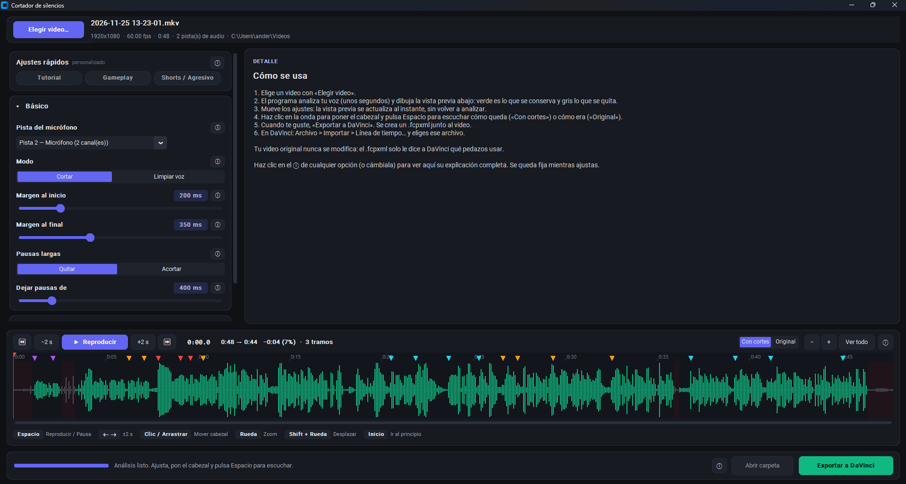
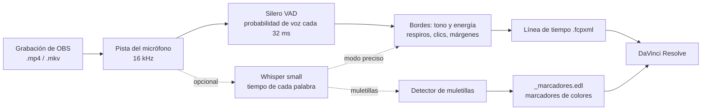

# Cortador de Silencios

[](https://github.com/Andercmdsena/cortador-de-silencios/actions/workflows/build.yml)
[](LICENSE)

**Quita los silencios de tus grabaciones con IA, para DaVinci Resolve.** Detecta *tu voz* con IA, no solo el volumen. Corta los silencios y exporta una línea de tiempo editable para DaVinci Resolve, sin volver a renderizar el video. También puede marcar muletillas («eh», «o sea»…) y frases repetidas con marcadores de colores.

🇬🇧 [Read in English](README.md)

<!-- Reemplazar por una captura real: docs/captura-ventana.png -->


## Por qué

*Remove Silence* de DaVinci Resolve, y herramientas como auto-editor, deciden por **volumen**: todo lo que queda por debajo de un umbral es «silencio». En la práctica:

- se comen las frases dichas bajito, y
- dejan respiros, clics de la boca y ruido del teclado, porque suenan lo bastante fuerte.

Cortador de Silencios usa **Silero VAD**, una red neuronal pequeña que reconoce la voz humana aunque sea suave. Además revisa el tono para distinguir tu voz de los respiros y los clics. Todos los cortes quedan editables en DaVinci, y tus archivos originales nunca se modifican.

## Funciones

- **Cortes por voz** (Silero VAD), con margen de entrada y de salida por separado y bordes inteligentes: el margen se detiene antes de un respiro, un clic de la boca o un resoplido nasal pegado a la frase.
- **Dos modos**
  - **Cortar:** quita los silencios de todas las pistas a la vez. El video, el micrófono y el audio del juego siguen sincronizados.
  - **Limpiar voz:** pensado para gameplay. El video y el juego no se tocan; solo se parte tu pista de micrófono, así desaparece el ruido entre frases sin perder ni un segundo de partida.
- **Grabaciones de OBS con varias pistas:** eliges la del micrófono y las demás se cortan exactamente en los mismos puntos.
- **Acortar pausas largas** en vez de quitarlas, para conservar el ritmo natural.
- **Vista previa en vivo:** la onda muestra en verde lo que se conserva y en gris lo que se quita, y se actualiza al instante al mover cualquier ajuste. Tiene cabezal que se puede arrastrar, reproducción continua *con cortes* u *original*, zoom y estadísticas.
- **Ajustes rápidos:** Tutorial, Gameplay, Shorts / Agresivo.
- **Modo preciso (Whisper, opcional):** corta al final de la última *palabra*, así también se van los suspiros con tono o un «mmm» después de la frase.
- **Marcadores de muletillas (Whisper, opcional):** marcadores de colores en DaVinci para
  - 🔴 sonidos de duda («eh», «mmm»),
  - 🟡 muletillas («o sea», «este…», «bueno,»),
  - 🟣 frases reiniciadas («es una… es una grabación»),
  - 🔵 palabras repetidas (la misma palabra 4 o más veces en 20 s).

  No se corta nada: tú decides.
- **Todo corre en tu PC.** Sin subir nada, sin cuentas, gratis.

## Cómo funciona



- El video **nunca se vuelve a codificar**: el `.fcpxml` solo le dice a DaVinci qué pedazos del archivo original usar.
- DaVinci solo toma la *primera* pista de audio de un video al importar un FCPXML. Por eso las pistas extra se copian sin pérdida a WAV en una carpeta `<video>_pistas` junto al video, y la línea de tiempo las usa desde ahí.
- DaVinci ignora los marcadores dentro de un FCPXML. Por eso las muletillas van en un archivo EDL aparte, con el formato de marcadores propio de DaVinci, que incluye color y duración.

## Instalación

### Opción 1: descargar el `.exe` (Windows 10/11)

1. Entra a [Releases](../../releases) y descarga `CortadorDeSilencios-vX.Y.Z-windows.zip`.
2. Descomprímelo donde quieras y abre `CortadorDeSilencios.exe`.

La primera vez que uses una función de Whisper se descarga solo el modelo `small` (~480 MB, necesita internet).

### Opción 2: desde el código

Necesitas Python 3.10 o superior ([python.org](https://www.python.org/)).

```bat
git clone https://github.com/Andercmdsena/cortador-de-silencios.git
cd cortador-de-silencios
instalar.bat      :: crea .venv e instala requirements.txt
cortador.bat      :: abre la ventana (puedes arrastrar un video encima)
```

También hay versión de consola:

```bat
.venv\Scripts\python cortar.py "C:\Videos\grabacion.mp4" --pista 2 --acortar 400
.venv\Scripts\python cortar.py --help
```

## Uso

1. **Elegir video…**: la voz se analiza en unos segundos.
2. Elige la **pista del micrófono**, el **modo** y un **ajuste rápido**, y afina los márgenes. El botón **ⓘ** de cada opción explica en el panel lateral qué hace.
3. Haz clic en la onda para poner el cabezal y pulsa **Espacio** para escuchar *con cortes* (u *original*).
4. **Exportar a DaVinci** crea `<video>_cortado.fcpxml` (o `_voz_limpia.fcpxml`) junto al video.
5. En DaVinci: **Archivo → Importar → Línea de tiempo…** y eliges el `.fcpxml`.
6. *(Si activaste las muletillas)* En el Panel multimedia, clic derecho sobre la línea de tiempo importada → **Líneas de tiempo → Importar → Marcadores de línea de tiempo desde EDL…** y eliges `<video>_…_marcadores.edl`.

No borres la carpeta `<video>_pistas`: la línea de tiempo la usa.

## Archivos

| Dónde | Qué |
|---|---|
| Junto al video | `_cortado.fcpxml` / `_voz_limpia.fcpxml`, `_marcadores.edl`, `_pistas/` (pistas en WAV y la transcripción de Whisper guardada) |
| `%APPDATA%\CortadorDeSilencios` | `config.json` (tus ajustes), `cortador.log`, `modelos/` (Whisper) |

Si ya tienes el modelo de Whisper descargado, pon su carpeta como `modelo-small` junto al programa o en `%APPDATA%\CortadorDeSilencios`, o define la variable de entorno `CORTADOR_MODELO`.

## Limitaciones

- **Whisper corre en el procesador:** aprox. 1–3 min por cada 10 min de video, una sola vez por video (queda guardado). Cortar silencios sin Whisper tarda segundos.
- Whisper ubica bien el **final** de las palabras, pero no siempre el **comienzo**. Por eso el inicio de cada frase lo decide el sonido, y los marcadores se ajustan a la ráfaga real de voz.
- **Sonidos pegados:** un suspiro con tono pegado a una palabra, sin pausa en medio, solo se quita con el modo preciso.
- **Calidad de la vista previa:** suena a 16 kHz mono. DaVinci usa tu audio original.
- **Plataformas:** probado en Windows 11 con DaVinci Resolve. El código también corre en Linux; en macOS no está probado.

## Desarrollo

```bat
probar.bat        :: pruebas (python -m unittest discover -s pruebas -v)
build.bat         :: genera dist\CortadorDeSilencios\ y un .zip con PyInstaller
```

- **Pruebas.** Las sintéticas siempre corren. Las de referencia comparan con cortes que el autor revisó a oído. En el repositorio solo están los *tiempos* (`pruebas/referencia.json`), no el audio, así que esas pruebas se saltan si no están las grabaciones.
- **CI.** GitHub Actions corre las pruebas y genera el `.exe` de Windows en cada push. Al publicar un tag `v*`, adjunta el `.zip` a la release.

```
cortar.py          motor + consola (detección, segmentación, exportación FCPXML/EDL, Whisper)
muletillas.py      detección de muletillas, reinicios y repeticiones
cortar_gui.pyw     ventana (CustomTkinter), vista previa y reproducción
ayuda.py           textos del panel de ayuda
pruebas/           pruebas con unittest
cortador.spec      configuración de PyInstaller
```

## Créditos

- [Silero VAD](https://github.com/snakers4/silero-vad): detección de voz.
- [faster-whisper](https://github.com/SYSTRAN/faster-whisper) / CTranslate2: Whisper en CPU. También trae el modelo ONNX de Silero.
- [PyAV](https://github.com/PyAV-Org/PyAV): lectura del audio de los videos (FFmpeg).
- [CustomTkinter](https://github.com/TomSchimansky/CustomTkinter): interfaz.
- [auto-editor](https://github.com/WyattBlue/auto-editor): su exportación FCPXML para DaVinci Resolve fue la referencia de cómo Resolve acomoda varias pistas de audio.

## Licencia

[MIT](LICENSE) © 2026 Anderson Tovar
