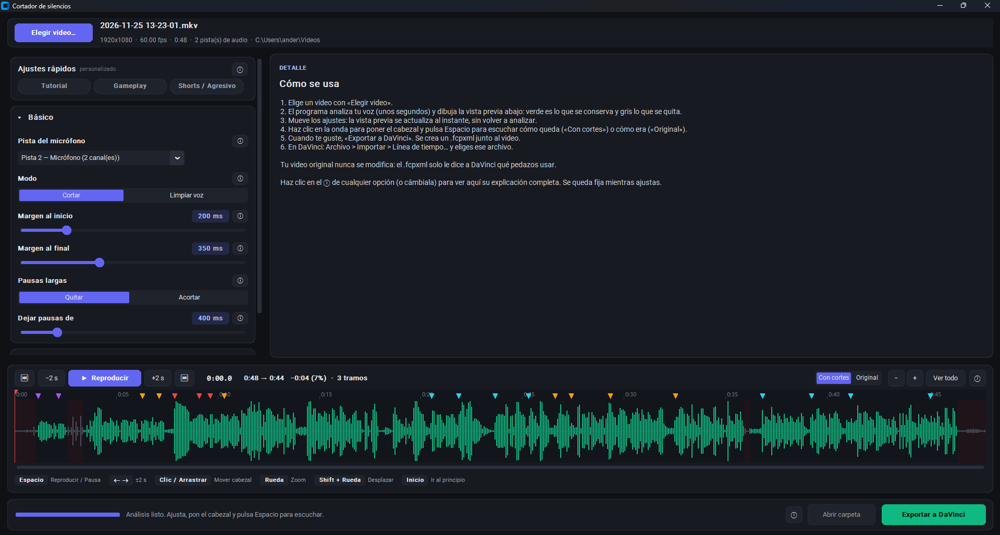
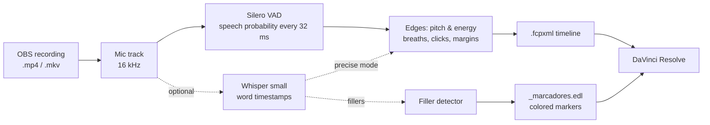

# Cortador de Silencios

[](https://github.com/Andercmdsena/cortador-de-silencios/actions/workflows/build.yml)
[](LICENSE)

**AI silence remover for DaVinci Resolve.** It detects *your voice* with AI (not just volume), cuts the silences and exports an editable timeline for DaVinci Resolve, without re-rendering your video. It can also mark filler words ("eh", "o sea"…) and restarted sentences as colored markers.

🇪🇸 [Leer en español](README.es.md)

<!-- Replace with a real screenshot: docs/captura-ventana.png -->


> The interface is in Spanish, and filler-word detection is tuned for Spanish speech.

## Why

DaVinci Resolve's built-in *Remove Silence* (and tools like auto-editor) decide by **volume**: everything below a threshold is "silence". In practice that means:

- phrases spoken softly get cut, and
- breaths, mouth clicks and keyboard noise are kept, because they are loud enough.

Cortador de Silencios uses **Silero VAD**, a small neural network that recognizes human speech even when it is quiet, plus a pitch-based check to tell your voice apart from breaths and clicks. All cuts stay editable in DaVinci: your original files are never modified.

## Features

- **Voice-based cutting** (Silero VAD) with separate lead-in / tail margins and smart edges: margins stop before a breath, a mouth click or a nasal exhale stuck to a phrase.
- **Two modes**
  - **Cortar (Cut):** removes silences from every track at once. Video, mic and game audio stay in sync.
  - **Limpiar voz (Clean voice):** for gameplay. The video and game audio are untouched and only your mic track is split, so noise between phrases disappears without losing a second of footage.
- **Multi-track OBS recordings:** choose the mic track. The other tracks are cut at exactly the same points.
- **Shorten long pauses** instead of removing them (keeps a natural rhythm).
- **Live preview:** waveform with kept (green) / removed (gray) parts, updated instantly as you move a setting. Includes a draggable playhead, continuous playback *with cuts* or *original*, zoom and stats.
- **Quick presets:** Tutorial, Gameplay, Shorts / Aggressive.
- **Precise mode (Whisper, optional):** cuts at the end of the last *word*, so voiced sighs or an "mmm" after a phrase are removed too.
- **Filler-word markers (Whisper, optional):** colored DaVinci markers for
  - 🔴 hesitation sounds ("eh", "mmm"),
  - 🟡 discourse fillers ("o sea", "este…", "bueno,"),
  - 🟣 restarted sentences ("es una… es una grabación"),
  - 🔵 overused words (the same word 4+ times in 20 s).

  Nothing is cut: you decide.
- **Runs 100 % locally.** No uploads, no account, free.

## How it works



- The video is **never re-encoded**: the `.fcpxml` just tells DaVinci which pieces of the original file to use.
- DaVinci only reads the *first* audio track of a video from an FCPXML. Extra tracks are therefore copied losslessly to WAV in a `<video>_pistas` folder next to the video, and referenced from the timeline.
- DaVinci ignores markers inside an FCPXML, so filler markers are written to a separate EDL file in DaVinci's own marker format, with colors and durations.

## Install

### Option 1: download the `.exe` (Windows 10/11)

1. Go to [Releases](../../releases) and download `CortadorDeSilencios-vX.Y.Z-windows.zip`.
2. Extract it anywhere and open `CortadorDeSilencios.exe`.

The first time you use a Whisper feature, the `small` model (~480 MB) is downloaded automatically (internet required).

### Option 2: from source

Requires Python 3.10+ ([python.org](https://www.python.org/)).

```bat
git clone https://github.com/Andercmdsena/cortador-de-silencios.git
cd cortador-de-silencios
instalar.bat      :: creates .venv and installs requirements.txt
cortador.bat      :: opens the window (you can drag a video onto it)
```

There is also a command-line version:

```bat
.venv\Scripts\python cortar.py "C:\Videos\recording.mp4" --pista 2 --acortar 400
.venv\Scripts\python cortar.py --help
```

## Usage

1. **Elegir video…** → the voice is analyzed in a few seconds.
2. Pick the **mic track**, a **mode** and a **preset**, then fine-tune the margins. Click any **ⓘ** to read what an option does in the side panel.
3. Click the waveform to place the playhead and press **Space** to listen *with cuts* (or *original*).
4. **Exportar a DaVinci** creates `<video>_cortado.fcpxml` (or `_voz_limpia.fcpxml`) next to the video.
5. In DaVinci: **File → Import → Timeline…** and choose the `.fcpxml`.
6. *(If filler markers are on)* In the Media Pool, right-click the imported timeline → **Timelines → Import → Timeline Markers from EDL…**, then choose `<video>_…_marcadores.edl`.

Keep the `<video>_pistas` folder: the timeline uses it.

## Files

| Where | What |
|---|---|
| Next to the video | `_cortado.fcpxml` / `_voz_limpia.fcpxml`, `_marcadores.edl`, `_pistas/` (WAV tracks and the cached Whisper transcription) |
| `%APPDATA%\CortadorDeSilencios` | `config.json` (your settings), `cortador.log`, `modelos/` (Whisper) |

To reuse a Whisper model you already have, put its folder as `modelo-small` next to the program or in `%APPDATA%\CortadorDeSilencios`, or set the `CORTADOR_MODELO` environment variable.

## Limitations

- **Whisper runs on the CPU:** roughly 1–3 min per 10 min of video, done once per video and cached. Silence cutting alone takes seconds.
- Whisper places the **end** of words well but not always the **start**. Phrase starts are therefore decided acoustically, and markers are snapped to the actual burst of speech.
- **Overlapping sounds:** a voiced sigh glued to a word, with no pause in between, can only be removed with precise mode.
- **Preview audio quality:** the preview plays 16 kHz mono audio. DaVinci uses your original audio.
- **Platforms:** tested on Windows 11 with DaVinci Resolve. The source code also runs on Linux; macOS is untested.

## Development

```bat
probar.bat        :: unit tests (python -m unittest discover -s pruebas -v)
build.bat         :: builds dist\CortadorDeSilencios\ and a .zip with PyInstaller
```

- **Tests.** Synthetic tests always run. Reference tests compare cuts against recordings the author reviewed by ear; only the cut *times* are in the repo (`pruebas/referencia.json`), not the audio, so those tests are skipped if the recordings aren't present.
- **CI.** GitHub Actions runs the tests and builds the Windows `.exe` on every push. Pushing a `v*` tag attaches the `.zip` to the release.

```
cortar.py          engine + CLI (detection, segmentation, FCPXML/EDL export, Whisper)
muletillas.py      filler-word / restart / repetition detection
cortar_gui.pyw     CustomTkinter window, live preview and playback
ayuda.py           help texts shown in the side panel
pruebas/           unittest suite
cortador.spec      PyInstaller config
```

## Credits

- [Silero VAD](https://github.com/snakers4/silero-vad): voice activity detection.
- [faster-whisper](https://github.com/SYSTRAN/faster-whisper) / CTranslate2: Whisper on CPU. It also bundles the Silero ONNX model.
- [PyAV](https://github.com/PyAV-Org/PyAV): reading audio from video files (FFmpeg).
- [CustomTkinter](https://github.com/TomSchimansky/CustomTkinter): interface.
- [auto-editor](https://github.com/WyattBlue/auto-editor): its DaVinci Resolve FCPXML export was the reference for how Resolve lays out multiple audio tracks.

## License

[MIT](LICENSE) © 2026 Anderson Tovar
